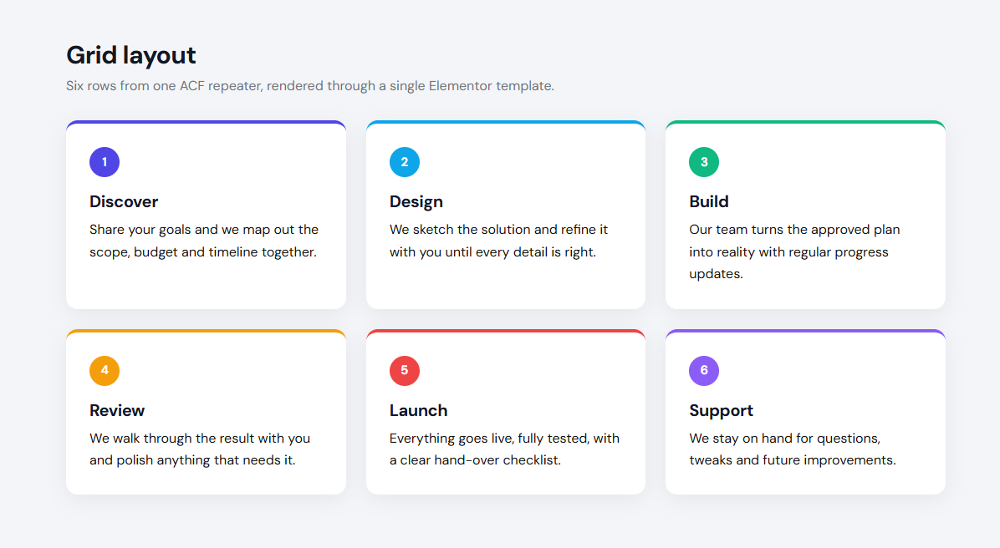
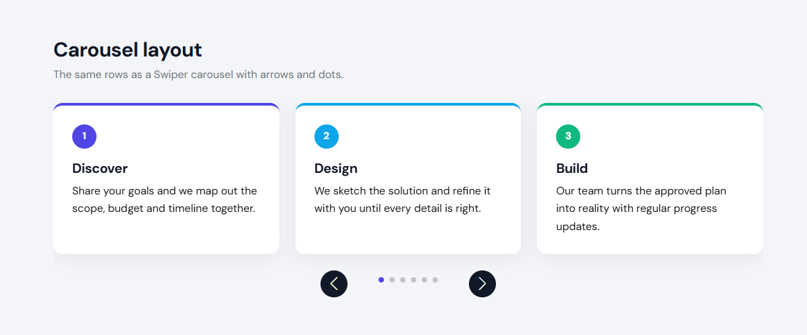
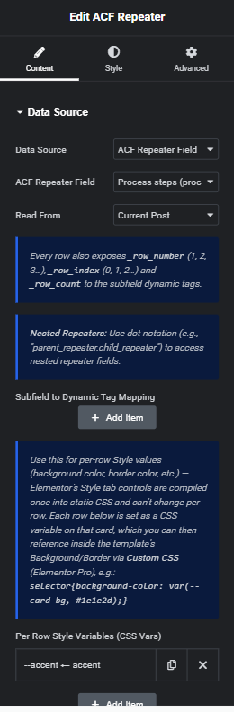
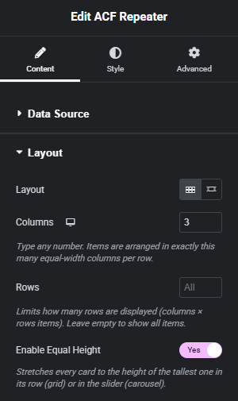
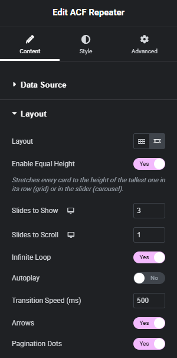
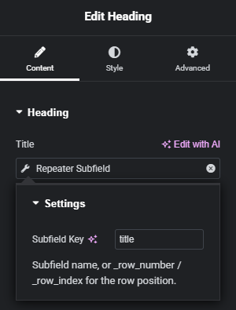

# ACF Repeater for Elementor

> Render any ACF Repeater field through an Elementor template you design yourself, as a responsive grid or a Swiper carousel, with dynamic tags that read each row's subfields.

**Version:** 2.0.0
**Author:** Noman Nadeem
**Requires:** [Elementor](https://wordpress.org/plugins/elementor/) (free is enough), [Advanced Custom Fields](https://wordpress.org/plugins/advanced-custom-fields/) (free or Pro)
**Widget:** *ACF Repeater* (search "repeater" in the Elementor panel)
**Dynamic tags:** *Repeater Subfield*, *Repeater Image*, *Repeater Gallery* (ACF group)

---

## Screenshots

One repeater with six rows, rendered through a single card template. The coloured top border and number badge change per row: the colour comes from a colour-picker subfield, the number from the built-in `_row_number` key.



The same rows as a carousel, with arrows, dots and equal-height slides.



| Data source | Grid settings | Carousel settings | Subfield tag |
|---|---|---|---|
|  |  |  |  |

---

## What it does

Elementor Pro's Loop Grid repeats a template over **posts**. This plugin does the same over the **rows of an ACF Repeater field**, which Elementor cannot do on its own.

1. You design one row (a card, a list item, a step, a testimonial) as a normal **Elementor template**.
2. Inside that template you bind widgets to the row's data with the **Repeater Subfield / Image / Gallery** dynamic tags.
3. You drop the **ACF Repeater** widget on a page or Theme Builder template, choose the repeater field and the template, and pick **Grid** or **Carousel**.

Every row is rendered through the template with its own data. Editors manage content in the familiar ACF repeater UI; the design stays in Elementor.

---

## Features

- **Three data sources**
  - **ACF Repeater Field** read from the current post, the ACF **Options page**, or a **specific post ID**.
  - **Parent Repeater Row (nested)**: place a second ACF Repeater widget inside the row template to render a repeater *inside* the current row (e.g. a list of bullet points per card).
  - **JSON Array**: paste rows as JSON, handy for prototypes or data that does not live in ACF.
- **Nested repeaters with dot notation**: `parent_repeater.child_repeater` flattens all inner rows into one list.
- **Grid layout**: any number of columns per breakpoint, column and row gap, optional row limit (columns × rows), equal-height cards.
- **Carousel layout** (bundled Swiper 8, loaded under its own handle so it never clashes with the Swiper version Elementor ships): slides to show and scroll per breakpoint, loop, autoplay with pause on hover, speed, arrows, dots, fixed or automatic slide height, equal-height slides, full arrow/dot styling.
- **Row position keys**: every row exposes `_row_number` (1, 2, 3…), `_row_index` (0, 1, 2…) and `_row_count`, for numbered steps and "1 / 6" counters.
- **Per-row style values**: map a subfield to a CSS variable on each card (e.g. `--accent`) and use it in the template's custom CSS. Elementor's own Style controls compile into one static stylesheet, so this is how a colour can differ per row.
- **Works with free Elementor**: the dynamic tags are built on Elementor core, not Pro. If Pro is missing the plugin registers the *ACF* tag group itself.
- **Clean output**: empty repeaters and setup mistakes (no template, no rows, invalid JSON) show a notice **only inside the Elementor editor**. Visitors see nothing rather than a broken block.
- **Fast**: the row template's CSS is printed once per page however many widgets use it, and is regenerated only when Elementor has no usable copy.

---

## Installation

1. Install and activate **Elementor** and **Advanced Custom Fields** (free or Pro).
2. Copy the `acf-repeater-for-elementor` folder into `wp-content/plugins/` and activate **ACF Repeater for Elementor**.

If either dependency is missing the plugin does nothing except show an admin notice saying which one.

---

## Quick start

**1. Create the field.** In ACF add a **Repeater** field, e.g. `process_steps`, with subfields `title` (Text), `description` (Textarea) and `accent` (Colour Picker). Fill in a few rows on a page.

**2. Design one row.** *Templates → Saved Templates → Add New → Container* (or Section). Build the card. For each widget that shows row data, click the dynamic-tags icon and choose:

| Widget control | Tag | Subfield Key |
|---|---|---|
| Heading title | Repeater Subfield | `title` |
| Text Editor | Repeater Subfield | `description` |
| Heading (badge) | Repeater Subfield | `_row_number` |
| Image | Repeater Image | `photo` |
| Gallery / Basic Gallery | Repeater Gallery | `photos` |
| Link / Button URL | Repeater Subfield | `link` |

Publish the template. In the template editor the tags have no row to read, so the widgets look empty there. That is expected.

**3. Place the widget.** Edit the page, add the **ACF Repeater** widget, then:

- *Data Source*: **ACF Repeater Field**
- *ACF Repeater Field*: `process_steps`
- *Read From*: **Current Post**
- *Elementor Template*: your card template
- *Layout*: **Grid** (set Columns) or **Carousel**

**4. (Optional) Per-row colour.** Under *Per-Row Style Variables* add `accent ← accent`. Then in the card template's *Advanced → Custom CSS* use it:

```css
selector { border-top: 4px solid var(--accent, #4F46E5); }
```

---

## Subfield values

The Subfield Key is the ACF subfield **name**. Besides the raw value, each row also carries some derived keys you can use directly:

| Subfield type | Extra keys |
|---|---|
| Image / File (array return) | `name_url`, `name_id`, `name_alt`, `name_title` |
| Select / Radio (value + label return) | `name_value`, `name_label` |
| Checkbox / multi-select | `name_text` (comma-separated) |
| Group or other arrays | `name_json` |
| Every row | `_row_number`, `_row_index`, `_row_count` |
| Dot-notation nested rows | `outer_*` and `inner_*` copies of each key, `_outer_index`, `_inner_index`, `_combined_index` |

*Repeater Subfield* returns text, URLs, colours and numbers, so it can be used in any text, URL, colour or number control. *Repeater Image* accepts an image array, attachment ID or URL. *Repeater Gallery* accepts a gallery field (array of images or IDs).

---

## Nested repeaters

Two ways, depending on the design:

- **Flatten** (`parent.child` in *ACF Repeater Field*): one grid or carousel containing every inner row. Outer values are available on each inner row as `outer_*`.
- **Per row** (*Parent Repeater Row* data source): put a second ACF Repeater widget **inside the row template** and enter the inner repeater's subfield name. Each outer card then renders its own inner list, through its own template.

---

## Options page and other posts

Set *Read From* to **Options Page** to read a repeater saved on an ACF Options page (site-wide testimonials, trust badges, office hours), or **Specific Post ID** to show one post's rows anywhere on the site.

---

## JSON data source

Paste an array of objects. Each object is one row and its keys work exactly like subfield names:

```json
[
  { "title": "Discover", "description": "Scope, budget and timeline.", "accent": "#4F46E5" },
  { "title": "Design",   "description": "Sketch and refine together.", "accent": "#0EA5E9" }
]
```

---

## For developers

| Item | Value |
|---|---|
| Widget name | `arfe_repeater_widget` |
| Dynamic tag names | `arfe_repeater_subfield`, `arfe_repeater_subfield_image`, `arfe_repeater_subfield_gallery` |
| Current row (while a row renders) | `$GLOBALS['arfe_repeater_context']` |
| Wrapper markup | `.arfe-repeater-wrapper.arfe-layout-{grid\|carousel}` → `.arfe-repeater-grid` or `.arfe-carousel.swiper` → `.arfe-repeater-item` |
| Script / style handles | `acf-repeater-for-elementor`, `arfe-swiper` |
| JS hook | `frontend/element_ready/arfe_repeater_widget.default` |

Shortcodes or custom widgets placed inside a row template can read the row directly:

```php
$row   = $GLOBALS['arfe_repeater_context'] ?? array();
$title = $row['title'] ?? '';
```

---

## Changelog

**2.0.0**
- Renamed to *ACF Repeater for Elementor*. New widget, tag, handle, class and global names (`arfe_*`). Templates built with 1.x must re-select the widget and tags.
- Equal height now works in the carousel layout too.
- Invalid JSON shows an editor-only notice instead of a red message on the live page.
- Data source labels are translatable.

**1.1.0**
- Options page and specific post ID sources.
- Parent Repeater Row (nested) source.
- `_row_number`, `_row_index`, `_row_count` row keys.
- Dynamic tags rebuilt on Elementor core, so they work without Elementor Pro.
- Template CSS printed once per page and cached.
- Empty states shown only in the editor.
- CSS variable names sanitised.

**1.0.0**
- Grid and carousel rendering of ACF repeaters and JSON through an Elementor template.

---

## Known limitations

- The row template shows empty placeholders in its own editor, because there is no row to read there. Preview it on a page that has rows.
- Elementor's Style tab values are the same for every row. Use *Per-Row Style Variables* for anything that must change per row.
- ACF Flexible Content layouts are not a data source; only Repeater fields (and JSON) are.

---

## License

GPLv2 or later.
